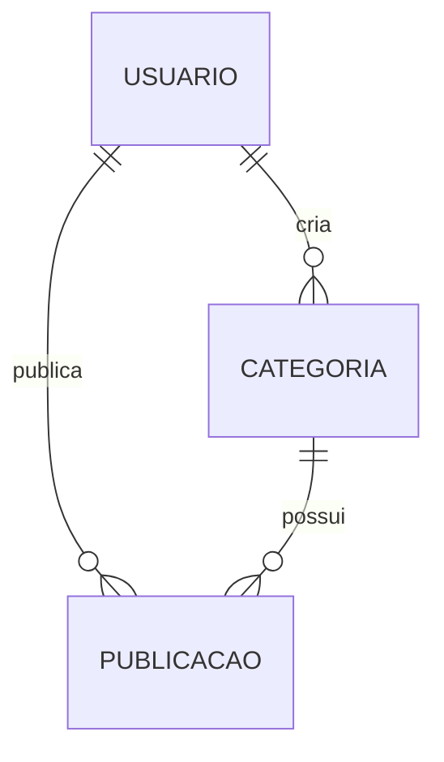

# BairrOn

API para registrar problemas e acontecimentos do bairro. Qualquer pessoa pode consultar. Para publicar, é preciso criar uma conta e fazer login.

## Como o projeto está organizado

Abra **BairrOn.slnx**. A solução tem somente o projeto da API.

- `Controllers`: recebe as requisições, confere as regras e acessa o banco.
- `Entities`: usuário, categoria e publicação.
- `DTOs`: dados recebidos nos cadastros e nas alterações.
- `Data`: conexão, tabelas e relacionamentos do Entity Framework.
- `Migrations`: arquivos gerados para criar e atualizar as tabelas.
- `Validation`: confere o fuso horário das datas recebidas.
- `requests/BairrOn.http`: exemplos para testar as rotas.
- `Program.cs`: configura Oracle, login e execução da API.

O fluxo é: requisição → controller → DbContext → Oracle → resposta. Não há camada de serviços ou projeto de testes na solução. Os comentários importantes estão em minúsculas.

## Tecnologias

ASP.NET Core 8, Entity Framework Core, Oracle da FIAP e autenticação JWT. As versões dos pacotes estão no `.csproj`. Senhas são salvas com hash, nunca em texto.

## Relacionamentos



## Como executar

Na pasta que contém o `.csproj`, execute no PowerShell:

```powershell
dotnet restore
dotnet tool restore
powershell -ExecutionPolicy Bypass -File .\scripts\configurar-local.ps1
```

O script pede usuário e senha do Oracle e salva a configuração fora do projeto. O padrão é `oracle.fiap.com.br:1521/ORCL`. Não coloque a senha no código ou no GitHub.

Depois de configurar o acesso ao seu schema autorizado:

```powershell
dotnet ef database update
$env:ASPNETCORE_ENVIRONMENT = 'Development'
dotnet run --project .\BairrOn.Api.csproj --urls http://localhost:5080
```

As Migrations criam `BRN_USUARIOS`, `BRN_CATEGORIAS`, `BRN_PUBLICACOES` e `BRN_MIGRATIONS`. Não é necessário criar tabelas à mão. A compatibilidade SQL está configurada para Oracle 19 e ainda precisa ser conferida no servidor real.

Para compilar pela solução:

```powershell
dotnet build BairrOn.slnx -c Release
```

## Como testar as rotas

Abra `requests/BairrOn.http`. Cadastre uma conta, faça login e copie o `accessToken` para a variável `token` do arquivo. Depois crie uma categoria e use o id retornado para cadastrar uma publicação.

| Rotas | Operações |
|---|---|
| `/api/auth/cadastro` e `/api/auth/login` | POST |
| `/api/usuarios/me` | GET, PUT e DELETE da própria conta |
| `/api/categorias` | GET e POST |
| `/api/categorias/{id}` | GET, PUT e DELETE |
| `/api/publicacoes` | GET e POST |
| `/api/publicacoes/{id}` | GET, PUT e DELETE |
| `/api/publicacoes/minhas` | GET das próprias publicações |
| `/api/publicacoes/{id}/resolucao` | PUT para resolver um problema |

Para filtrar: `/api/publicacoes?tipo=Problema&situacao=Aberto`. Também pode usar `categoriaId`.

As criações retornam 201; alterações e exclusões, 204. Dados inválidos retornam 400; falta de login, 401; ação de outro autor, 403; id inexistente, 404; registro vinculado ou e-mail repetido, 409. Os erros tratados retornam uma mensagem JSON; erros de campos usam a validação do ASP.NET. O 401 do token pode vir sem corpo.

## Regras principais

- Só o autor pode editar ou excluir sua publicação, mesmo quando ela é anônima.
- O anonimato esconde a identidade nas respostas públicas. O autor continua registrado no banco. O conteúdo publicado pode revelar a identidade se a própria pessoa escrever dados pessoais.
- Só o criador altera ou exclui a categoria. Uma categoria em uso não pode ser excluída nem mudar de tipo.
- Problemas ficam abertos até o autor resolver. A edição não reabre um problema resolvido.
- Acontecimentos exigem início e encerramento, com encerramento posterior ao início. A situação muda conforme o horário.
- Envie datas com fuso, como `2026-11-15T09:00:00-03:00`. As datas são guardadas em UTC.
- Endereço é obrigatório; ponto de referência é opcional. Esta versão não tem fotos ou mapa visual.
- O login vale por uma hora. Trocar a senha ou excluir a conta bloqueia os tokens antigos.

## Conferência no Oracle

```sql
SELECT ID, NOME, EMAIL FROM BRN_USUARIOS;
SELECT ID, NOME, TIPO FROM BRN_CATEGORIAS;
SELECT ID, TITULO, CATEGORIAID, ANONIMA FROM BRN_PUBLICACOES;
```

As migrations foram aplicadas no Oracle da FIAP. A equipe testou operações pelo Swagger e conferiu os registros com consultas SQL. Essa validação foi feita manualmente no schema configurado.

## Dados da entrega

Nome 	          RM 	    Turma
Murillo Kenzo 	RM566948 	2TDSPA
Kauan Prado 	RM566990 	2TDSPA
Cauã Rocha 	    RM567593 	2TDSPR
Gustavo Souza 	RM567134 	2TDSPR
